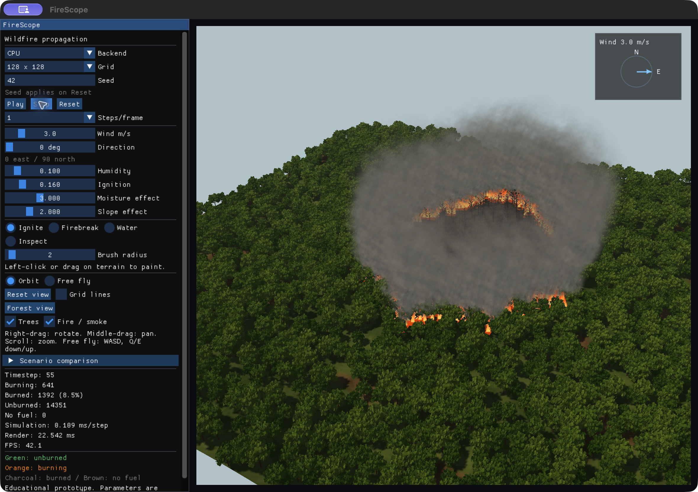
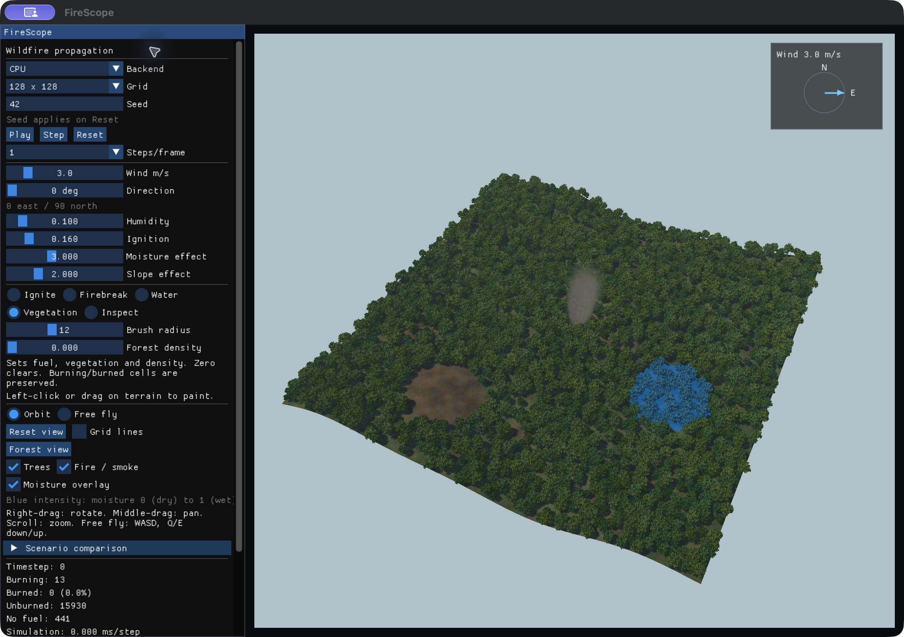

# FireScope

FireScope is a cross-platform GPU-accelerated wildfire propagation and
mitigation simulator developed as a combined Computer Graphics/VR and
Parallel Architecture/GPU Programming college project.

Compute backends: serial CPU and Apple Metal (verified on Mac); NVIDIA CUDA
(implemented, awaiting NVIDIA-machine validation); optional OpenMP remains future
work. Implementation follows [the specification](docs/PROJECT_SPEC.md).

> Educational prototype, not intended for operational wildfire forecasting.

## Build and run

Requirements: CMake 3.24+, a C++17 compiler, and OpenGL 4.1 support.
On macOS use Xcode/Command Line Tools; on Windows use Visual Studio C++ tools.
The first GUI configuration downloads pinned GLFW, GLM and Dear ImGui releases.

```sh
cmake -S . -B build -DCMAKE_BUILD_TYPE=Release
cmake --build build --config Release -j
ctest --test-dir build -C Release --output-on-failure
```

On macOS, open `build/FireScope.app` in Finder, or run:

```sh
./build/FireScope.app/Contents/MacOS/FireScope
```

On Windows (Visual Studio generator):

```powershell
.\build\Release\FireScope.exe
```

On Linux with a suitable OpenGL installation: `./build/FireScope`.

The Mac build and GUI have been tested locally. Windows portability is designed
into the sources and CMake configuration but requires Windows validation.

## Current controls

- CPU/Metal/CUDA selector shows only backends compiled and available on this device.
  Switching backend resets the seeded scenario.
- Play / Pause / Step / Reset.
- Seed (applies on Reset) and 128² / 256² / 512² / 1024² grid selection.
- Wind speed/direction, humidity, ignition probability and moisture/slope strengths.
- Ignite / Firebreak / Water / Vegetation brushes, radius 1–30. Click/drag to paint.
  Water adds the chosen amount per stamp and saturates moisture at 1; it does not
  directly extinguish existing fires. Vegetation sets fuel, vegetation and density
  to the chosen value, clears at zero, and can regrow NoFuel cells. It preserves
  burning and burned cells. Tree instances refresh when the stroke ends.
- Moisture overlay tints terrain and foliage blue according to actual cell moisture.
  Selecting Water enables it; the checkbox can turn it off.
- Steps per frame: 1 / 2 / 4 / 8; compact render state downloaded once per frame.
- Burning, burned, unburned and no-fuel counts, timestep, timing and FPS.
- Orbit camera: right-drag to rotate, middle-drag to pan, scroll to zoom.
- Free-fly camera: right-drag to look, WASD to move, Q/E down/up.
- Reset view reframes the terrain; Grid lines toggles the cell overlay.
- A terrain cursor shows the picked cell and elevation; the ring previews brush radius.
- Trees and Fire / smoke toggles control the branching forest, animated leaf cards,
  flames, glow and wind-driven smoke. Trees lose foliage as cells burn.
- Forest view gives a closer, lower-angle orbit view; Reset view restores full framing.
- Terrain uses procedural soil/grass/rock detail, directional shadows and atmospheric haze.
- A wind compass shows east/north direction and speed.
- Inspect pauses on cell selection and shows state, fuel, moisture, elevation,
  vegetation, density, burn age, burning neighbors and combined ignition probability.
  Step records the selected cell's last observed probability. Inspector readbacks
  add overhead; close the inspector for normal performance measurements.
- Escape closes the window.

Reset restores the seeded forest and the same central ignition, clears painted
edits and pauses. It retains the current environment controls. 0° wind blows east;
90° blows north. Green means unburned, orange burning, charcoal burned, brown no fuel.
The viewer now renders a lit 3D heightfield with perspective projection and depth
buffering. Ray picking intersects the actual terrain triangles before painting.

Use `--triangle` to replay the original OpenGL/ImGui skeleton.
Use `--smoke-test` to run five simulation/render frames and check OpenGL errors.

## Headless CPU build

No OpenGL or downloaded dependencies are needed for this build:

```sh
cmake -S . -B build-headless -DCMAKE_BUILD_TYPE=Release -DFIRESCOPE_BUILD_GUI=OFF
cmake --build build-headless --config Release -j
ctest --test-dir build-headless -C Release --output-on-failure
./build-headless/FireScope --backend cpu --grid 128 --steps 500 --seed 42 --headless
```

On Windows the headless executable is `build-headless/Release/FireScope.exe`.
Headless output is CSV with the columns from the specification. Initialization,
scenario generation and rendering are excluded from the timed interval. Counts
are included in simulation time. These single runs are smoke measurements;
use `--benchmark` for one warm-up plus five runs and median reporting.

## Milestone status

- M0: Mac CMake/OpenGL 4.1/ImGui triangle verified; Windows verification pending.
- M1: CPU model and deterministic tests pass; basic texture visualization works.
- M2: 3D terrain, orbit/free-fly camera, depth buffering and ray picking implemented.
- M3: CUDA source and tests ready; Windows/CUDA runtime checks pending.
- M4: Metal compute, CPU parity, 512² 3D live run, and CPU/Metal benchmarks verified.
- M5: Water, vegetation painting, moisture overlay, full scenario capture/restore and paired mitigation comparison work on CPU/Metal.
- M6: branching instanced trees, leaf cards, shadows, sky, detailed terrain, flame billboards, wind-driven smoke, wind compass and cell inspector implemented.
  CUDA shared-memory optimization, NVIDIA validation and final presentation checks remain.

## Report and presentation material

- Editable report: `output/documents/FireScope_Report.docx`.
- Reviewed nine-page report PDF: `output/pdf/FireScope_Report.pdf`.
- A2 landscape poster: `output/pdf/FireScope_Poster.pdf`.
- [Demo sequence and technical rehearsal notes](docs/DEMO_GUIDE.md).
- [Report prose source](docs/REPORT.md).

The report follows all 19 sections in the specification. These files omit personal
and college identifiers and mark CUDA validation/shared-memory optimization as
pending. The backup demo video and projector checks remain outstanding.
`scripts/create_deliverables.py` rebuilds the DOCX and poster from checked-in
evidence using python-docx, ReportLab and Pillow. Set `FIRESCOPE_FONT_DIR` to a
directory containing LiberationSans-Regular.ttf and LiberationSans-Bold.ttf on
another machine. Render and inspect the DOCX before exporting its final PDF.

See [architecture](docs/architecture.md), [model choices](docs/model.md), and
[dependencies/attribution](THIRD_PARTY.md). No source from the referenced wildfire
repositories has been copied. Repository licensing has not yet been selected by
the team; third-party dependencies retain their own licenses.

## GPU validation and benchmark results

```sh
./build/FireScope.app/Contents/MacOS/FireScope --list-backends
./build/FireScope.app/Contents/MacOS/FireScope --backend metal --grid 512
python3 scripts/run_benchmarks.py --executable build/FireScope.app/Contents/MacOS/FireScope --backends cpu metal --output benchmarks/results/mac.csv
```

The default development configuration remains CPU / 128². Metal shader source is
embedded and compiled at runtime, so the app does not require a working directory
containing `.metal` files or a separate metallib compiler. GPU discovery/tests
need device access; a sandbox-skipped test is not validation.

See [measured results](docs/PERFORMANCE.md) and [NVIDIA validation instructions](docs/NVIDIA_VALIDATION.md).
Plot graphs using `scripts/plot_results.py` after installing
`scripts/requirements-lock.txt` in a virtual environment. The Mac data and PNG/PDF
graphs are checked in under `benchmarks/results/`.

## Mitigation demo

1. Choose a backend/grid and set the environmental controls.
2. Expand **Scenario comparison**, then **Capture** to pause and save the scenario.
3. Paint a firebreak/wet zone, or select **Demo firebreak** for a complete barrier
   east of the central ignition. Keep the simulation paused.
4. Set **Run steps**, then **Compare mitigation**. Both runs use the captured seed,
   environment and logical timestep; the view shows the final mitigated run.
5. Read baseline/mitigated burned counts and relative reduction. **Restore** returns
   to the original snapshot so another intervention can be tested.

Snapshots are held in memory for this session and capture all cell properties and
burn age. Reset/grid/backend changes discard them. If you advance the simulation
after capture, restore before comparing. Camera controls remain independent.
These are educational scenario comparisons, not calibrated forecasts.


## Graphics preview



The upgraded renderer takes visual cues from the
[CIS565 wildfire reference](https://github.com/anthonymansur/CIS565-Final-Project).
Our trees and shaders are procedural; smoke uses bounded particles. The cellular
simulation and its benchmark path remain independent of these visual effects.



