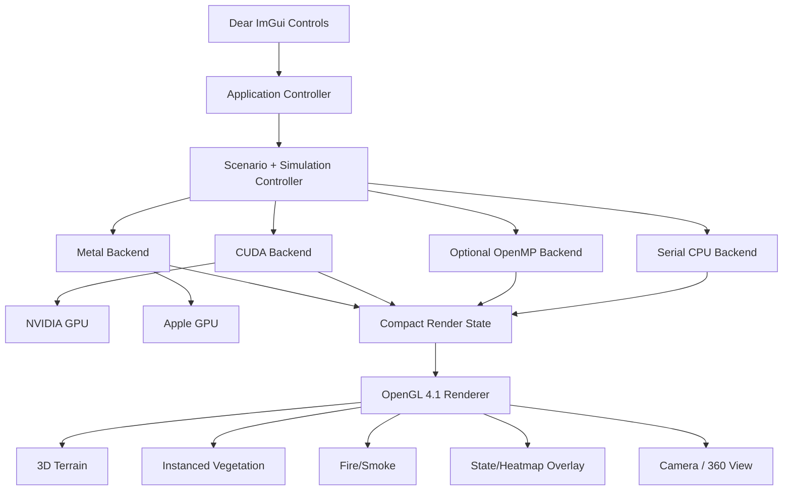

# FireScope
## Cross-Platform GPU-Accelerated Wildfire Propagation & Mitigation Simulator

**Project type:** Combined Experiential Learning project  
**Courses:** Computer Graphics & Virtual Reality + Parallel Architecture & GPU Programming  
**Team size:** 3  
**Primary compute backends:** Serial CPU + NVIDIA CUDA + Apple Metal  
**Optional backend:** OpenMP  
**Graphics:** OpenGL 4.1-compatible renderer + GLFW + GLM + Dear ImGui  
**Primary SDGs:** SDG 13 (Climate Action), SDG 15 (Life on Land)  
**Optional SDG:** SDG 11 (Sustainable Cities and Communities)

---

# 1. Project in one paragraph

FireScope is an interactive wildfire simulator. The forest is represented internally as a large 2D cellular grid, while the result is visualized as a 3D terrain/forest in OpenGL. Every cell stores burn state, fuel, moisture, vegetation/density and terrain elevation. At every timestep, unburned cells can ignite depending on nearby burning cells, wind, slope, vegetation and moisture. The exact same simulation model is implemented on a serial CPU, an NVIDIA GPU using CUDA, and an Apple GPU using Metal. The user can ignite regions, change environmental conditions, draw firebreaks, add wet zones and compare a baseline wildfire with a mitigated run. The project therefore combines GPU parallelism, performance analysis, 3D graphics, transformations, interaction and a real-world SDG-oriented application.

> FireScope is an educational/research prototype, **not** a certified operational wildfire forecasting system.

---

# 2. Why it fits both courses

## Computer Graphics & VR side

The project demonstrates:

- OpenGL graphics pipeline
- vertex/fragment shaders
- model/view/projection transformations
- 3D terrain modelling
- perspective projection
- depth buffering and visible-surface handling
- camera movement and 360-degree/free-fly inspection
- keyboard/mouse event handling
- ray-based mouse picking
- instanced vegetation rendering
- billboards/particles for fire and smoke
- textures and overlays
- behaviour modelling
- interactive real-world engineering visualization

## Parallel Architecture/GPU side

The project demonstrates:

- data-level parallelism
- one-thread-per-cell decomposition
- CUDA threads, blocks and grids
- Metal threads and threadgroups
- GPU memory hierarchy
- global/device buffers
- constant parameters
- shared/threadgroup memory
- coalesced access
- double buffering to remove races
- serial vs parallel timing
- speedup and throughput
- heterogeneous GPU portability

---

# 3. Recommended title and pitch

## Title

**FireScope: Cross-Platform GPU-Accelerated Wildfire Propagation and Mitigation Simulator**

## One-line pitch

> An interactive wildfire decision-support prototype that updates hundreds of thousands to millions of terrain cells in parallel using CUDA or Metal, renders the result in OpenGL, and lets users test mitigation strategies such as firebreaks and wet zones.

---

# 4. Reference repositories

These are references/bases to study. Do not blindly clone and rename them.

## 4.1 Parallel wildfire reference

### Vinnu124/WildFire-Simulation-IPC
https://github.com/Vinnu124/WildFire-Simulation-IPC

Useful because it contains an Alexandridis-style cellular wildfire model implemented with:

- serial CPU
- OpenMP
- CUDA
- MPI
- MPI + OpenMP
- deterministic hash-based PRNG
- benchmark scripts
- 16x16 CUDA blocks
- double-buffered state
- shared-memory tiling
- constant-memory parameters

**Use it primarily for:** simulation model, CUDA decomposition, benchmark methodology and optimization ideas.

**Do not submit it unchanged.** FireScope should add substantial original work: Metal, OpenGL 3D visualization, cross-platform backend abstraction, interaction, scenario comparison, firebreak/water tools and your own benchmarks.

---

## 4.2 Graphics/CUDA wildfire reference

### anthonymansur/CIS565-Final-Project
https://github.com/anthonymansur/CIS565-Final-Project

This is a more visually ambitious CUDA + OpenGL wildfire simulation with:

- C++/CUDA compute
- OpenGL rendering
- 3D forest geometry
- GPU simulation buffers
- branch/module combustion concepts
- fire and smoke visualization ideas

**Use it primarily for:** renderer architecture, visualization ideas, GPU-buffer organization and inspiration for fire/smoke/vegetation.

**Do not start by reproducing its full physical combustion model.** A simpler cellular model with a strong renderer is far more manageable for this EL project.

---

## 4.3 Additional reference

### herewegoblueno/team-wildfire
https://github.com/herewegoblueno/team-wildfire

Useful for:

- interactive ignition ideas
- physically-inspired wind/convection ideas
- CUDA-optional architecture concepts
- visual presentation ideas

---

## 4.4 Supporting libraries/resources

### NVIDIA CUDA samples
https://github.com/NVIDIA/cuda-samples

Use for CUDA setup, device queries, timing and reference kernel patterns.

### Dear ImGui
https://github.com/ocornut/imgui

Use the GLFW + OpenGL3 backend for the common UI.

### GLFW
https://github.com/glfw/glfw

Use for window creation, OpenGL context and input.

### GLM
https://github.com/g-truc/glm

Use for vectors, matrices, projection, camera transforms and picking.

### stb
https://github.com/nothings/stb

Optional for heightmaps/textures.

### Apple Metal-cpp
https://developer.apple.com/metal/cpp/

Optional alternative to an Objective-C++ wrapper if you want a more C++-centric Metal integration.

---

# 5. Scientific/model reference

A useful basis is:

**Alexandridis, A., Vakalis, D., Siettos, C. I., & Bafas, G. V. (2008). _A cellular automata model for forest fire spread prediction: The case of the wildfire that swept through Spetses Island in 1990._ Applied Mathematics and Computation 204(1), 191–201.**

DOI: https://doi.org/10.1016/j.amc.2008.06.046

The model considers factors such as vegetation, density, wind speed/direction and terrain slope. FireScope should implement a clearly documented simplified/derived version suitable for GPU parallelization and interactive visualization.

---

# 6. Licensing and academic integrity

Before copying code from any reference repository:

1. Check for an explicit license.
2. Preserve notices/attribution.
3. Cite repositories and papers in the report.
4. Document what your team wrote versus what was adapted.
5. Prefer reimplementing the algorithm from the paper/description rather than copying large code sections.

The reviewed GitHub pages for the two primary wildfire repos did not clearly expose a top-level license in the listing used during review. Until you verify the repository contents yourself, treat their source as **reference material** rather than automatically redistributable code.

Create:

```text
THIRD_PARTY.md
```

and list every external dependency/reference.

---

# 7. System architecture



## Critical design rule

**Compute and rendering stay separate.**

Do this:

```text
CPU/CUDA/Metal -> compact render state -> OpenGL
```

Do not make CUDA directly own the renderer in the MVP. Direct CUDA/OpenGL interoperability can be a stretch optimization later.

---

# 8. Platform strategy

## NVIDIA desktop

Use:

- C++17 or C++20
- CUDA
- OpenGL
- GLFW
- GLM
- Dear ImGui
- CMake

Available backends:

```text
CPU
CUDA
Optional OpenMP
```

## Mac presentation build

Use:

- C++17 or C++20
- Objective-C++ wrapper for Metal (`.mm`)
- Metal compute shader (`.metal`)
- OpenGL 4.1 Core Profile
- GLFW
- GLM
- Dear ImGui
- CMake/Xcode toolchain

Available backends:

```text
CPU
Metal
```

### Recommended Metal wrapper

```text
MetalBackend.hpp   -> normal C++ interface
MetalBackend.mm    -> Objective-C++ implementation
wildfire.metal     -> Metal compute kernel
```

This keeps almost all of the application in ordinary C++.

---

# 9. macOS OpenGL constraint

Target **OpenGL 4.1 Core or lower**.

Use shaders compatible with:

```glsl
#version 410 core
```

Avoid depending on:

- OpenGL compute shaders
- OpenGL 4.5/4.6-only calls
- NVIDIA-only extensions
- compute logic implemented as GLSL SSBO kernels

Compute lives in CUDA/Metal; OpenGL is only for graphics.

---

# 10. Recommended repository structure

```text
FireScope/
│
├── CMakeLists.txt
├── README.md
├── THIRD_PARTY.md
├── LICENSE
│
├── cmake/
│   ├── Dependencies.cmake
│   ├── CudaConfig.cmake
│   └── MacMetal.cmake
│
├── include/firescope/
│   ├── SimulationBackend.hpp
│   ├── SimulationTypes.hpp
│   ├── Scenario.hpp
│   ├── SimulationStats.hpp
│   ├── Renderer.hpp
│   ├── Camera.hpp
│   └── App.hpp
│
├── src/
│   ├── main.cpp
│   ├── core/
│   │   ├── Scenario.cpp
│   │   ├── SimulationController.cpp
│   │   ├── TerrainGenerator.cpp
│   │   └── DeterministicRNG.cpp
│   ├── backends/
│   │   ├── cpu/
│   │   │   ├── CPUBackend.cpp
│   │   │   └── CPUBackend.hpp
│   │   ├── openmp/
│   │   │   ├── OpenMPBackend.cpp
│   │   │   └── OpenMPBackend.hpp
│   │   ├── cuda/
│   │   │   ├── CUDABackend.cu
│   │   │   ├── CUDABackend.hpp
│   │   │   └── wildfire_cuda.cuh
│   │   └── metal/
│   │       ├── MetalBackend.mm
│   │       ├── MetalBackend.hpp
│   │       └── wildfire.metal
│   ├── render/
│   │   ├── OpenGLRenderer.cpp
│   │   ├── Shader.cpp
│   │   ├── TerrainMesh.cpp
│   │   ├── VegetationRenderer.cpp
│   │   ├── ParticleRenderer.cpp
│   │   └── DebugOverlay.cpp
│   └── ui/
│       ├── UI.cpp
│       └── ScenarioPanel.cpp
│
├── shaders/
│   ├── terrain.vert
│   ├── terrain.frag
│   ├── vegetation.vert
│   ├── vegetation.frag
│   ├── billboard.vert
│   └── billboard.frag
│
├── assets/
│   ├── heightmaps/
│   ├── textures/
│   └── screenshots/
│
├── benchmarks/
│   └── results/
│
├── scripts/
│   ├── run_benchmarks.py
│   └── plot_results.py
│
├── tests/
│   ├── test_rng.cpp
│   ├── test_cpu_sim.cpp
│   └── test_backend_consistency.cpp
│
└── docs/
    ├── PROJECT_SPEC.md
    ├── architecture.md
    └── model.md
```

---

# 11. Simulation grid

Start development at:

```text
128 x 128
```

Then support:

```text
256 x 256
512 x 512
1024 x 1024
```

Optional stress test:

```text
2048 x 2048
```

For the live Mac demo, default to **512²** and offer **1024²** as an option. Do not make the presentation depend on the largest possible grid.

---

# 12. Cell states

```cpp
enum class CellState : uint32_t {
    NoFuel   = 0,
    Unburned = 1,
    Burning  = 2,
    Burned   = 3
};
```

| State | Meaning |
|---|---|
| `NoFuel` | road, rock, water, empty area, firebreak |
| `Unburned` | burnable vegetation |
| `Burning` | actively burning |
| `Burned` | fuel consumed |

Do not create a separate `Wet` state. Moisture is a continuous property.

---

# 13. Data layout

Prefer **Structure of Arrays (SoA)** for GPU-friendly access.

Conceptually:

```cpp
struct GridData {
    std::vector<uint32_t> state;
    std::vector<float> fuel;
    std::vector<float> moisture;
    std::vector<float> elevation;
    std::vector<float> vegetation;
    std::vector<float> density;
    std::vector<uint32_t> burnTicks;
};
```

Why SoA:

- coalesced GPU access
- easier partial transfers
- avoids cross-API struct-padding problems
- renderer can download only the fields it needs

---

# 14. Double buffering

Never update the grid in place.

```text
Current state (read only)
        |
        v
   simulation kernel
        |
        v
Next state (write only)
```

Then swap buffers.

This prevents one cell from reading a neighbor that has already been modified in the same timestep and avoids race/order problems.

---

# 15. Environment parameters

Suggested structure:

```cpp
struct EnvironmentParams {
    float baseIgnitionProbability;
    float windSpeed;
    float windDirectionRadians;
    float globalHumidity;
    float moistureStrength;
    float slopeStrength;
    float windStrength;
    float fuelConsumptionRate;
    float cellSizeMeters;
    uint32_t minimumBurnTicks;
    uint32_t seed;
    uint32_t timestep;
};
```

Suggested UI ranges:

| Parameter | Range |
|---|---:|
| Wind speed | 0–20 m/s |
| Wind direction | 0–360° |
| Global humidity | 0–1 |
| Base ignition probability | 0–1 |
| Moisture | 0–1 |
| Vegetation | 0–1 |
| Density | 0–1 |
| Brush radius | 1–30 cells |

Treat values as simulation parameters unless/until calibrated.

---

# 16. Fire-spread model

For an unburned target cell and a burning neighbor:

```text
P_neighbor =
    P_base
    x vegetation_factor
    x density_factor
    x wind_factor
    x slope_factor
    x moisture_factor
```

Clamp to `[0, 1]`.

Possible factors:

```text
vegetation_factor = 1 + vegetation_modifier
density_factor    = 1 + density_modifier
moisture_factor   = exp(-Km * moisture)
```

Wind factor inspired by the Alexandridis-style model:

```text
wind_factor =
    exp(K1 * windSpeed)
    x
    exp(windSpeed * K2 * (cos(relativeAngle) - 1))
```

Slope factor:

```text
slope = atan((targetElevation - sourceElevation) / distance)
slope_factor = exp(Ks * slope)
```

Store all constants in one configuration structure so they can be tuned.

---

# 17. Neighborhood and probability combination

Use an 8-neighbor Moore neighborhood:

```text
NW  N  NE
 W  X   E
SW  S  SE
```

For every burning neighbor, compute `P_neighbor`.

Combine:

```text
P_total = 1 - product(1 - P_neighbor_i)
```

Then:

```text
if deterministicRandom < P_total:
    ignite
```

Cardinal distance is `cellSize`; diagonal distance is `sqrt(2) * cellSize`.

---

# 18. Burning logic

```text
UNBURNED
   |
   | ignition succeeds
   v
BURNING
   |
   | fuel decreases
   v
BURNED
```

Conceptually:

```cpp
if (state == Burning) {
    nextFuel = std::max(0.0f, fuel - burnRate);
    nextState = (nextFuel <= 0.0f) ? Burned : Burning;
}
```

Rendering intensity can be derived from fuel remaining and burn age. A full combustion-temperature model is not required for the MVP.

---

# 19. Deterministic random numbers

Do not use ordinary global `rand()` in the simulation.

Create a deterministic unsigned-integer hash based on:

```text
seed
x
y
timestep
```

Example interface:

```cpp
uint32_t hashCell(
    uint32_t seed,
    uint32_t x,
    uint32_t y,
    uint32_t step
);
```

Then map the result to `[0,1)` or compare against an integer probability threshold.

Benefits:

- reproducible scenarios
- fair before/after mitigation comparisons
- easier backend testing
- no mutable RNG state per cell

For better CPU/CUDA/Metal consistency, quantize probability to a 32-bit integer threshold and compare against the same integer PRNG result.

---

# 20. Core update pseudocode

```text
for each cell in parallel:

    if NO_FUEL:
        next = NO_FUEL

    else if BURNED:
        next = BURNED

    else if BURNING:
        reduce fuel
        if fuel <= 0:
            next = BURNED
        else:
            next = BURNING

    else if UNBURNED:
        P_total = 0

        for each of 8 neighbors:
            if neighbor is BURNING:
                compute vegetation effect
                compute density effect
                compute wind effect
                compute slope effect
                compute moisture effect
                combine into P_total

        r = deterministicRandom(seed, x, y, timestep)

        if r < P_total:
            next = BURNING
        else:
            next = UNBURNED
```

---

# 21. Common backend interface

Implement the CPU model **first**, behind a backend interface.

```cpp
class ISimulationBackend {
public:
    virtual ~ISimulationBackend() = default;
    virtual const char* name() const = 0;

    virtual void initialize(
        const SimulationConfig& config,
        const InitialGrid& grid
    ) = 0;

    virtual void reset(const InitialGrid& grid) = 0;

    virtual void step(
        const EnvironmentParams& params,
        uint32_t stepCount = 1
    ) = 0;

    virtual void downloadRenderState(RenderState& out) = 0;
    virtual SimulationStats stats() const = 0;
};
```

Implementations:

```text
CPUBackend
OpenMPBackend (optional)
CUDABackend
MetalBackend
```

The application/UI should not care which one is active.

---

# 22. CPU backend acceptance criteria

Before touching CUDA/Metal, the serial backend must:

- run a 128² grid
- spread fire correctly
- reset correctly
- reproduce the same result from the same seed
- respond to wind
- respond to moisture
- respond to slope
- respect firebreaks
- report burned/burning/unburned counts
- pass small deterministic tests

---

# 23. CUDA backend

## Basic decomposition

One CUDA thread per cell.

Recommended block:

```text
16 x 16 = 256 threads
```

Launch shape:

```cpp
dim3 block(16, 16);
dim3 grid(
    (width  + 15) / 16,
    (height + 15) / 16
);
```

Conceptually:

```cpp
wildfireStep<<<grid, block>>>(...);
```

## Device buffers

```text
state A / state B
fuel A / fuel B
burnTicks A / burnTicks B
moisture
elevation
vegetation
density
```

Static arrays such as elevation/vegetation do not need to be transferred every frame.

Global parameters can be held in a small structure; CUDA constant memory is a later optimization.

---

# 24. CUDA shared-memory optimization

First implement a plain global-memory kernel.

Then add a tiled kernel.

For a 16x16 block, load an 18x18 state tile into shared memory:

```text
16x16 interior
+ 1-cell halo on all sides
= 18x18 shared tile
```

Workflow:

1. threads load center cells
2. edge threads load halo cells
3. synchronize
4. inspect 8 neighbors from shared memory
5. compute new state
6. write one result to global memory

Benchmark:

```text
CUDA naive
vs
CUDA tiled/shared-memory
```

This gives you a very strong memory-hierarchy experiment for viva/report.

---

# 25. Metal backend

Map the same algorithm to Metal.

| CUDA | Metal |
|---|---|
| device | `MTLDevice` |
| kernel | compute function |
| `cudaMalloc` | `MTLBuffer` |
| thread block | threadgroup |
| global thread ID | thread position in grid |
| `__shared__` | `threadgroup` memory |
| constant parameters | `constant` address space / small buffer |
| kernel launch | compute encoder dispatch |

Start with a simple global-memory Metal implementation. Add threadgroup-memory optimization only after correctness.

## First Metal test

Before porting wildfire, run something trivial:

```text
output[i] = input[i] + 1
```

Verify the result. Then port the wildfire kernel. Do not debug Metal initialization and wildfire mathematics simultaneously.

---

# 26. Optional OpenMP backend

A useful optional backend:

```cpp
#pragma omp parallel for collapse(2) schedule(static)
```

This gives a simple shared-memory CPU comparison between serial CPU and GPU.

It is valuable, but not required for the first milestone.

---

# 27. Compact render state

Do not transfer every simulation field to OpenGL.

Example:

```cpp
struct RenderState {
    uint32_t width;
    uint32_t height;
    std::vector<uint8_t> cellState;
    std::vector<uint8_t> fireIntensity;
};
```

For a 1024² grid, two bytes per cell is about 2 MB per displayed frame, which is reasonable for this project architecture.

---

# 28. OpenGL rendering strategy

Do not create a separate cube for every simulation cell.

Upload state as a 2D texture:

```text
simulation grid -> OpenGL texture -> terrain fragment shader
```

Suggested state appearance:

| State | Color/appearance |
|---|---|
| NoFuel | rock/road/dark |
| Unburned | green |
| Burning | orange/red/emissive |
| Burned | black/charcoal |

Use a second channel/texture for fire intensity or debug values.

---

# 29. 3D terrain

The simulation is a 2D X/Z grid; elevation turns it into a 3D world.

Terrain vertex:

```text
(x, elevation[x,z], z)
```

Use:

- VBO
- EBO/index buffer
- normals
- simple directional lighting
- model/view/projection matrices

## MVP terrain

Procedural hills using layered sine/value noise.

## Stretch terrain

Heightmap image or real DEM data.

Do not make GIS input a requirement for the first working build.

---

# 30. Vegetation rendering

Sample a subset of vegetation cells and render low-poly trees with **instancing**.

Simple tree:

```text
trunk = cylinder/cuboid
canopy = cone/sphere
```

Per-instance transforms demonstrate translation, scale and rotation while keeping draw-call count low.

---

# 31. Fire and smoke visualization

## MVP

Terrain surface changes color for burning cells.

## Final

Add billboard particles.

Fire particle:

```text
position
size
age
intensity
```

Smoke particle:

```text
position
velocity
age
opacity
size
```

Smoke motion can use:

```text
upward drift + wind drift + small random turbulence
```

Keep particle count bounded so the visual effect does not become the main bottleneck.

---

# 32. Camera modes

## Orbit camera

- drag to rotate
- scroll to zoom
- pan

## Free-fly / 360-degree camera

- WASD
- mouse look
- QE up/down

This provides a useful 360-degree/VR-style inspection mode without making the project dependent on a headset.

Optional stretch: OpenXR headset mode on a supported machine.

---

# 33. Mouse picking

Convert screen coordinates into a world-space ray:

```text
mouse pixel
 -> normalized device coordinates
 -> inverse projection
 -> view-space ray
 -> inverse view matrix
 -> world-space ray
 -> terrain intersection
 -> simulation cell
```

Use this for interactive tools. This is also excellent material for the graphics viva.

---

# 34. Interactive tools

Toolbar:

```text
[Ignite] [Firebreak] [Water] [Vegetation] [Inspect]
```

## Ignite

Click/drag to ignite cells. Support multiple ignition points and brush radius.

## Firebreak

Paint cells to `NoFuel`. Render them as cleared soil/road-like strips.

## Water/wet zone

Increase `moisture`, for example:

```text
moisture = min(1, moisture + brushStrength)
```

Optional moisture decay over time.

## Vegetation

Paint density/fuel to create dense forest, sparse forest and cleared regions.

## Inspect

Click a cell and show:

```text
coordinate
state
fuel
moisture
elevation
vegetation
density
burn age
number of burning neighbors
last ignition probability
```

This makes the simulator much easier to explain during viva.

---

# 35. UI layout and controls

Suggested UI:

```text
+----------------------------------------------------------+
| FireScope                                                |
+-----------------------+----------------------------------+
| Simulation Controls   |                                  |
| Backend: Metal        |                                  |
| Grid: 512 x 512       |          3D VIEW                 |
| Seed: 42              |                                  |
| [Play] [Pause]        |                                  |
| [Step] [Reset]        |                                  |
| Wind speed            |                                  |
| Wind direction        |                                  |
| Humidity              |                                  |
| Brush/tool            |                                  |
+-----------------------+----------------------------------+
| Burning | Burned | Sim ms | Render ms | FPS              |
+----------------------------------------------------------+
```

Required controls:

- play/pause
- single-step
- reset
- backend selector
- grid size
- seed
- simulation speed
- steps per frame
- wind speed/direction
- humidity/moisture
- ignition probability
- burn rate
- tool/brush radius
- view mode
- overlay type

Unavailable backends should appear disabled.

---

# 36. Wind visualization

Render a 3D or HUD arrow and text:

```text
Wind: 8.0 m/s
Direction: 135°
```

The arrow should visibly rotate when the direction changes.

---

# 37. Signature feature: baseline vs mitigation

The strongest demo is a controlled A/B comparison.

## Run A — baseline

Run the scenario with no intervention and record:

- burned cells
- burned percentage
- total timesteps
- peak simultaneously burning cells
- compute time

## Run B — mitigation

Restore exactly the same initial scenario and seed, add firebreak/water, then rerun.

Display:

```text
Baseline burned:     X%
Mitigated burned:    Y%
Reduction:           X-Y percentage points
Relative reduction: ...%
```

This turns the project into an engineering decision-support demonstration rather than only an animation.

---

# 38. Scenario snapshot

Store:

- seed
- terrain
- vegetation
- moisture
- ignition points
- environment parameters

Flow:

```text
Initial snapshot
   |--> baseline run
   |
   +--> restore -> apply mitigation -> mitigated run
```

---

# 39. Statistics

Suggested structure:

```cpp
struct SimulationStats {
    uint64_t noFuel;
    uint64_t unburned;
    uint64_t burning;
    uint64_t burned;
    uint64_t timestep;
    double simulationMs;
    double renderMs;
    double frameMs;
};
```

Derived metrics:

- burned %
- active fire %
- simulation steps/sec
- million cell updates/sec
- speedup over serial CPU

---

# 40. Benchmark mode

Add a headless mode so rendering does not distort simulation measurements.

Examples:

```bash
FireScope --backend cpu --grid 512 --steps 500 --seed 42 --headless
FireScope --backend cuda --grid 1024 --steps 500 --seed 42 --headless
FireScope --backend metal --grid 1024 --steps 500 --seed 42 --headless
```

Benchmark sizes:

```text
128²
256²
512²
1024²
2048² (optional)
```

Use the same seed, initial forest and parameters.

Method:

1. warm-up run
2. five measured runs
3. report median
4. optionally mean/stddev

CSV columns:

```csv
backend,device,grid,steps,seed,total_ms,ms_per_step,mcell_updates_per_s,burned_final
```

Do not reuse performance numbers from reference repositories as your results.

---

# 41. Performance graphs

Generate:

1. **Grid size vs execution time**
2. **Grid size vs speedup**
3. **Million cell updates/sec**
4. **CUDA naive vs shared-memory tiled**

Speedup:

```text
speedup = serial CPU time / backend time
```

Primary final comparison:

```text
Serial CPU
Optional OpenMP
Metal on Mac
CUDA on NVIDIA GPU
```

---

# 42. Correctness tests

## No ignition
No burning cells -> grid remains unchanged.

## Probability = 1
Known neighbors must ignite exactly.

## Firebreak
Complete no-fuel barrier must stop fire when ember spotting is disabled.

## Moisture
Wet scenario should spread less than identical dry scenario under your model.

## Wind
Strong wind should bias spread direction.

## Reproducibility
Same seed + grid + parameters -> same result on same backend.

## Backend consistency
Small deterministic scenario should match CPU/CUDA/Metal. Prefer integer-threshold random comparisons to minimize floating-point divergence.

---

# 43. Optimization experiments

These make the project academically stronger:

## Experiment 1
Serial CPU vs CUDA.

## Experiment 2
Serial CPU vs Metal.

## Experiment 3
CUDA global-memory kernel vs shared-memory tiled kernel.

## Experiment 4
Transfer render state every simulation step vs only once per visible frame.

## Experiment 5 — optional
Array of Structures vs Structure of Arrays.

---

# 44. Decouple simulation and render rates

Do not require one render for every simulation step.

Example:

```text
simulation: 200 steps/sec
render:      60 frames/sec
```

UI setting:

```text
Steps per frame: 1 / 2 / 4 / 8
```

---

# 45. MVP definition

The MVP is complete when:

- [ ] one repository builds on Windows and Mac
- [ ] GLFW window works
- [ ] OpenGL renderer works
- [ ] Dear ImGui works
- [ ] CPU wildfire works
- [ ] deterministic seed works
- [ ] wind works
- [ ] moisture works
- [ ] slope/elevation works
- [ ] ignite tool works
- [ ] firebreak tool works
- [ ] 3D camera works
- [ ] terrain state visualization works
- [ ] CUDA backend works
- [ ] Metal backend works
- [ ] backend selector works
- [ ] serial/CUDA/Metal timings work
- [ ] Mac build is presentation-ready

If you reach this point, the project is already strong.

---

# 46. Final feature set

After MVP:

- [ ] 512² default live scenario
- [ ] 1024² selectable scenario
- [ ] low-poly instanced trees
- [ ] fire billboards
- [ ] smoke particles
- [ ] water tool
- [ ] inspector tool
- [ ] wind arrow
- [ ] scenario snapshot
- [ ] before/after mitigation comparison
- [ ] benchmark graphs
- [ ] CUDA shared-memory optimization
- [ ] debug overlays
- [ ] 360-degree/free-fly camera
- [ ] report
- [ ] poster
- [ ] backup demo video

---

# 47. Stretch goals

Only after the final core feature set is stable:

## Simulation

- ember spotting
- variable wind over time
- more vegetation types
- moisture evaporation
- water drops
- roads/rivers
- settlement/buildings
- real terrain/DEM

## Parallel computing

- MPI
- hybrid MPI + OpenMP
- OpenACC
- CUDA streams
- asynchronous copies
- direct CUDA/OpenGL interop
- more advanced Metal optimization

## Graphics/VR

- volumetric smoke
- bloom/post-processing
- day/night cycle
- first-person incident-commander mode
- OpenXR headset mode where supported

---

# 48. Things NOT to start with

Avoid scope explosion. Do not begin with:

- full atmospheric CFD
- Navier–Stokes smoke
- combustion chemistry
- satellite/weather ingestion
- ML prediction
- real GIS server
- multiplayer
- mobile app

The strength is:

```text
parallel algorithm
+ interactive graphics
+ measurable performance
+ mitigation comparison
```

---

# 49. Team-of-3 split

## Member 1 — Simulation + CUDA

- CPU reference model
- deterministic PRNG
- CUDA backend
- shared-memory optimization
- CUDA profiling/benchmarks
- correctness tests

## Member 2 — OpenGL + interaction

- shaders
- 3D terrain
- camera
- vegetation instancing
- fire/smoke
- mouse picking
- UI interaction

## Member 3 — Metal + analytics

- Metal backend
- Mac build
- scenario snapshot
- firebreak/water integration
- stats
- benchmark scripts/graphs
- SDG/report integration

Everyone should still understand the whole architecture.

---

# 50. Git workflow

Recommended branches:

```text
main      -> stable/demo-ready
develop   -> integration
feature/* -> feature work
```

Examples:

```text
feature/cpu-simulation
feature/cuda-backend
feature/metal-backend
feature/opengl-terrain
feature/firebreak-brush
feature/benchmark-ui
```

Useful issue labels:

```text
simulation
cuda
metal
graphics
ui
benchmark
bug
report
stretch
```

Use meaningful commits such as:

```text
Implement deterministic cell hash
Add serial CA update
Add wind-relative ignition factor
Add OpenGL terrain mesh
Add ray-to-terrain picking
Add CUDA backend
Add Metal compute dispatch
```

---

# 51. First-day plan

## Step 1
Create the repository and folder structure.

## Step 2
Make the same OpenGL triangle appear on Windows and Mac.

## Step 3
Add Dear ImGui and display:

```text
FireScope
Backend: CPU
Grid: 128
[Play] [Reset]
```

## Step 4
Implement a 128x128 CPU cellular fire model.

## Step 5
Visualize it as a simple 2D texture/quad.

## Step 6
Add deterministic seed 42 and confirm reset reproduces the same run.

At the end of Day 1 / early Day 2, aim to have a tiny but complete wildfire program.

---

# 52. First-week plan

## Milestone A — CPU model

- grid/state
- deterministic PRNG
- wind
- moisture
- slope
- tests

## Milestone B — OpenGL

- terrain
- camera
- state texture
- mouse picking

## Milestone C — CUDA

- simple kernel
- timing
- CPU comparison

At this point the NVIDIA build should already look like a real project.

---

# 53. Second-week plan

## Milestone D — Metal

- allocate buffers
- compile compute pipeline
- dispatch
- download compact state
- compare with CPU

## Milestone E — Mitigation

- firebreak
- water
- snapshots
- before/after results

## Milestone F — graphics polish

- trees
- flame billboards
- smoke
- inspector
- UI polish

---

# 54. Final-week plan

Focus on reliability:

- benchmark all backends
- produce graphs
- repeatedly test the Mac build
- test external display/projector scaling
- freeze dependencies
- record backup video
- finish poster/report
- practice viva

Do not redesign the architecture during the final days.

---

# 55. CMake strategy

Conceptually:

```cmake
project(FireScope LANGUAGES CXX)

option(FIRESCOPE_ENABLE_CUDA "Enable CUDA backend" ON)
option(FIRESCOPE_ENABLE_METAL "Enable Metal backend" ON)
option(FIRESCOPE_ENABLE_OPENMP "Enable OpenMP backend" OFF)

find_package(OpenGL REQUIRED)

if(APPLE)
    enable_language(OBJCXX)
    # Link Metal, Foundation, QuartzCore, OpenGL
endif()
```

CUDA should only compile when a CUDA compiler exists. Metal code should only compile on Apple platforms. The common app must still compile without CUDA.

---

# 56. Setup checklist

## Windows/NVIDIA

Install:

- Visual Studio C++ tools
- CMake
- Git
- current NVIDIA driver
- CUDA Toolkit compatible with the installed GPU/toolchain

Verify:

```bash
cmake --version
nvcc --version
nvidia-smi
git --version
```

## Mac

Install:

- Xcode
- Xcode Command Line Tools
- CMake
- Git

If not vendoring GLFW:

```bash
brew install cmake glfw
```

Verify:

```bash
xcode-select -p
clang++ --version
cmake --version
```

Before integrating FireScope, independently prove:

1. OpenGL triangle works.
2. Tiny Metal compute kernel works.

---

# 57. Dependency strategy

Use either:

- CMake `FetchContent`, or
- Git submodules.

Good candidates:

```text
GLFW
GLM
Dear ImGui
```

Once the project works, **pin exact tags/commits**. Do not rely on moving `master` branches during presentation week.

---

# 58. Command-line options

Recommended:

```text
--backend cpu|openmp|cuda|metal
--grid N
--steps N
--seed N
--headless
--benchmark
--scenario path
```

Examples:

```bash
FireScope --backend cpu --grid 256 --seed 42
FireScope --backend cuda --grid 1024 --steps 1000 --benchmark --headless
FireScope --backend metal --grid 512 --seed 42
```

---

# 59. Presentation demo sequence

## 1. Start on the Mac

Show:

```text
Backend: Metal
Grid: 512 x 512
```

Explain that the same algorithm also has a CUDA backend on the NVIDIA machine.

## 2. Ignite the forest

Run once with low wind.

## 3. Change wind

Reset to the same seed, apply strong wind and show the directional change.

## 4. Baseline

Run a known scenario and record burned percentage.

## 5. Firebreak

Restore the same scenario, draw a firebreak and rerun.

Show baseline vs mitigation numbers.

## 6. Performance

Show benchmark plots for:

```text
Serial CPU
Metal
CUDA
```

CUDA results can be measured beforehand on the NVIDIA desktop.

## 7. Code mapping

Briefly show CUDA and Metal kernels and explain one-thread-per-cell plus blocks/threadgroups.

---

# 60. Presentation fallback plan

Carry:

- stable Mac build
- known-good scenario
- benchmark PNG/PDFs
- screenshots
- full demo video
- local copy of source

Do not depend on internet during the demo.

Avoid updating major toolchains/OS/dependencies immediately before presentation.

---

# 61. SDG mapping

## SDG 13 — Climate Action

Suggested wording:

> FireScope supports climate-hazard education by allowing users to visualize how environmental factors and intervention strategies influence wildfire spread.

## SDG 15 — Life on Land

Suggested wording:

> FireScope provides an interactive environment for studying wildfire impact on forested land and comparing mitigation strategies intended to reduce vegetation and habitat loss.

## Optional SDG 11

Use only if you add settlements, roads or infrastructure and discuss wildland–urban interface risk.

---

# 62. Limitations to state explicitly

- simplified cellular model
- no certified real-weather integration
- no operational calibration
- simplified fuel/moisture categories
- simplified suppression strategies
- educational/research prototype only

Stating limitations improves credibility.

---

# 63. Report outline

1. Abstract
2. Problem statement
3. SDG relevance
4. Related work
5. System architecture
6. Cellular wildfire model
7. Data structures
8. CPU implementation
9. CUDA implementation
10. Metal implementation
11. OpenGL visualization
12. Interaction and mitigation
13. Experimental methodology
14. Performance results
15. Scenario comparison
16. Limitations
17. Future work
18. Conclusion
19. References

---

# 64. Poster outline

```text
TITLE / TEAM

PROBLEM
Wildfire spread depends on environment and is computationally expensive.

OBJECTIVE
Interactive GPU-accelerated simulation + mitigation planning.

ARCHITECTURE
CPU / CUDA / Metal -> OpenGL

MODEL
Cellular automata + wind + moisture + slope

GRAPHICS
3D terrain + interaction + particles

PARALLELIZATION
1 thread per cell + shared-memory optimization

RESULTS
CPU vs Metal vs CUDA plots

MITIGATION
Before vs after firebreak

SDGs
13 + 15

LIMITATIONS
Educational prototype
```

---

# 65. Viva questions to prepare

## Parallel/GPU

1. Why is wildfire spread data-parallel?
2. What does one GPU thread process?
3. Why double buffering?
4. What are CUDA blocks and warps?
5. Where can branch divergence occur?
6. Why use 16x16 blocks?
7. Why shared memory?
8. What is a halo tile?
9. What is coalesced access?
10. Why Structure of Arrays?
11. How is speedup measured?
12. Why can the same model run in CUDA and Metal?
13. Why can't CUDA run on the Mac?
14. What is the difference between discrete NVIDIA memory and Apple unified memory?
15. Why transfer only compact render state?

## Graphics

1. Explain model/view/projection.
2. What does the depth buffer do?
3. What is instanced rendering?
4. What is a billboard?
5. How do you blend transparency?
6. How do you create a world-space mouse ray?
7. How is terrain represented?
8. What does the fragment shader do?
9. Why OpenGL 4.1-compatible features?

## Simulation

1. Why cellular automata?
2. Which factors affect ignition?
3. Why deterministic random numbers?
4. How does wind affect spread?
5. How does slope affect spread?
6. How does a firebreak work?
7. Why is FireScope not a production predictor?

---

# 66. How to describe your contribution

Do not say:

> We found a wildfire project and ported it.

A fair, strong description is:

> We studied existing GPU wildfire implementations and a published cellular model, then built a cross-platform simulation architecture with CPU, CUDA and Metal backends; created an OpenGL 3D visualization and interaction layer; added mitigation planning and reproducible scenario comparison; and evaluated performance across heterogeneous GPU platforms.

---

# 67. Originality checklist

Aim for at least:

- [ ] your own common backend abstraction
- [ ] your own CPU model implementation
- [ ] your own Metal backend
- [ ] your own OpenGL renderer or substantial renderer work
- [ ] your own firebreak interaction
- [ ] your own water/moisture interaction
- [ ] your own scenario comparison
- [ ] your own benchmarks
- [ ] your own cross-platform build
- [ ] your own analysis/report

If CUDA code is adapted, attribute it and document changes.

---

# 68. Suggested README opening

```markdown
# FireScope

FireScope is a cross-platform GPU-accelerated wildfire propagation and
mitigation simulator developed as a combined Computer Graphics/VR and
Parallel Architecture/GPU Programming project.

Compute backends:
- Serial CPU
- NVIDIA CUDA
- Apple Metal
- Optional OpenMP

Simulation state is visualized through an interactive OpenGL 3D renderer.
Users can change environmental parameters, ignite regions, create firebreaks,
apply wet zones and compare mitigation outcomes.

> FireScope is an educational prototype and is not intended for operational
> wildfire forecasting.
```

---

# 69. Implementation order — follow this

```text
1. Cross-platform CMake/window
2. OpenGL triangle
3. Dear ImGui
4. CPU cellular simulation
5. Deterministic PRNG
6. Wind/moisture/slope
7. Grid rendered as texture
8. 3D terrain
9. Mouse picking
10. Firebreak brush
11. CUDA backend
12. CPU vs CUDA benchmarks
13. Tiny standalone Metal compute test
14. Metal wildfire backend
15. CPU vs Metal benchmarks
16. Scenario comparison
17. Trees/fire/smoke polish
18. CUDA shared-memory optimization
19. Graphs/report/poster
```

**Do not start with fancy particles.** Get the simulation and cross-platform architecture correct first.

---

# 70. Milestone acceptance tests

## M0 — Skeleton

- Windows builds
- Mac builds
- OpenGL triangle
- ImGui

## M1 — CPU

- 128² grid
- deterministic seed
- fire spreads
- reset works

## M2 — Graphics

- 3D terrain
- camera
- state colors
- picking

## M3 — CUDA

- matches deterministic CPU tests
- 512² benchmark works
- no memory errors

## M4 — Metal

- matches deterministic CPU tests
- 512² live run works on Mac
- backend selectable

## M5 — Mitigation

- firebreak
- water
- snapshot
- before/after numbers

## M6 — Final

- repeated demo is stable
- benchmark CSV exists
- plots exist
- report exists
- poster exists
- backup video exists

---

# 71. Risk register

| Risk | Mitigation |
|---|---|
| Reference CUDA code tightly coupled to graphics | Reimplement compute behind your own backend interface |
| Mac cannot use CUDA | Metal backend |
| macOS OpenGL feature mismatch | Stay at OpenGL 4.1 Core |
| CUDA/Metal floating behavior diverges | deterministic integer PRNG + quantized threshold |
| Visuals too plain | 3D terrain + trees + billboards after core works |
| Physics scope explodes | use cellular automata, not CFD |
| Render transfers cost too much | transfer compact state only once per visible frame |
| Licensing unclear | verify licenses / reimplement / attribute |
| Team merge conflicts | stable interfaces + feature branches |
| Live demo failure | stable build + known-good scenario + backup video |

---

# 72. Best final scope

```text
Cellular wildfire
+ wind
+ slope
+ moisture
+ CPU
+ CUDA
+ Metal
+ OpenGL 3D terrain
+ vegetation
+ firebreak
+ water
+ scenario comparison
+ benchmarks
```

This is enough. Do not add unrelated features merely to increase feature count.

---

# 73. Final project statement

**FireScope is a cross-platform, GPU-accelerated wildfire propagation and mitigation simulator that combines a cellular-automata fire model with interactive OpenGL visualization. The same simulation is implemented across serial CPU, NVIDIA CUDA and Apple Metal backends, enabling performance comparison across heterogeneous architectures. Users can modify environmental parameters and apply mitigation measures such as firebreaks and wet zones, then compare outcomes using reproducible scenarios. The system is an educational prototype aligned primarily with SDG 13: Climate Action and SDG 15: Life on Land.**

---

# 74. Priority order if time gets tight

1. Correct CPU simulation
2. OpenGL 3D visualization
3. CUDA backend
4. Metal backend
5. Firebreak interaction
6. Performance comparison
7. Baseline-vs-mitigation analysis
8. Graphics polish
9. OpenMP
10. Stretch features

The first seven items are the core project.

---

# 75. Start-now checklist

- [ ] Create the `FireScope` repository
- [ ] Put this file at `docs/PROJECT_SPEC.md`
- [ ] Create `THIRD_PARTY.md`
- [ ] Add CMake
- [ ] Add GLFW
- [ ] Add GLM
- [ ] Add Dear ImGui
- [ ] Open an OpenGL window on Windows
- [ ] Open the same OpenGL window on Mac
- [ ] Render a 128x128 CPU wildfire grid
- [ ] Add deterministic seed
- [ ] Add wind
- [ ] Add firebreak
- [ ] Commit after each milestone
- [ ] Only then begin CUDA

**First major goal:**

> CPU wildfire + OpenGL visualization running from one repository on both Windows and macOS.

Once that works, CUDA and Metal are backend ports rather than separate projects.
