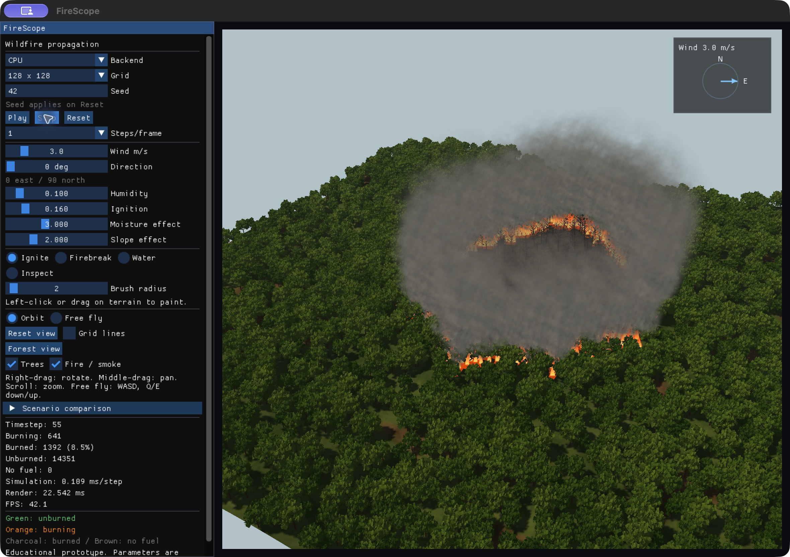
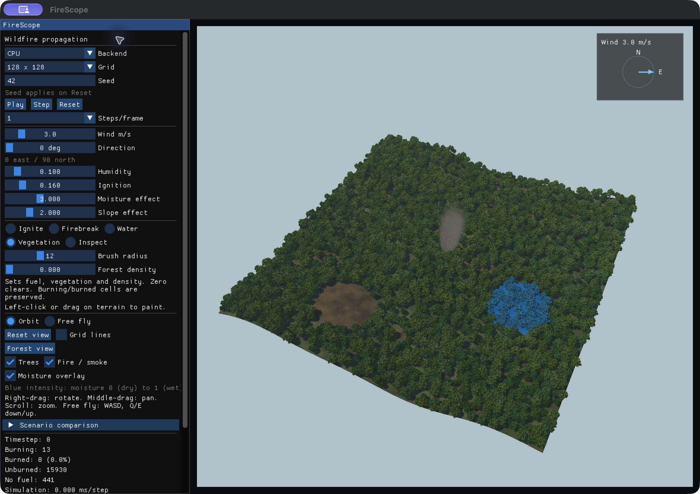
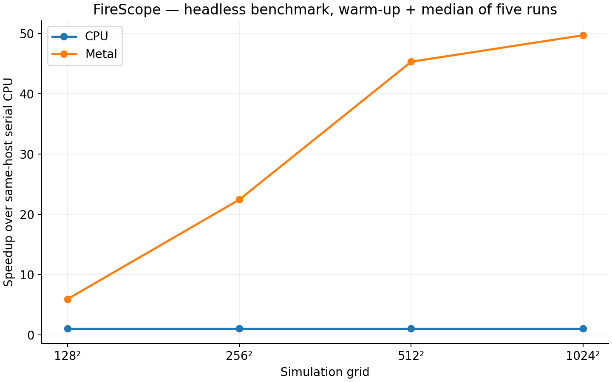

# FireScope wildfire simulation project report

FireScope combines a cellular wildfire model with interactive 3D graphics and paired mitigation experiments. This report describes the implementation, its verified behavior and measured performance. The Mac CPU and Metal backends pass the correctness suite; the CUDA source awaits compilation and validation on an NVIDIA computer.

Implementation and measurements reviewed on 7 October 2026. The project is an educational prototype with uncalibrated model parameters.

---

## 1 Abstract

FireScope demonstrates GPU parallelism through wildfire spread and mitigation. A two-dimensional grid stores cell state, fuel, moisture, elevation, vegetation, density and burn age. Synchronous updates combine the influence of eight neighboring cells with wind, slope and moisture, using a deterministic random hash. A shared interface supports serial CPU, Apple Metal and NVIDIA CUDA implementations. OpenGL presents the state as a terrain and forest with camera controls, picking, fire and smoke. On an Apple M5 Pro, the measured headless Metal step API was 45.31 times faster than the CPU step API at 512 by 512 cells for a batch of 500 timesteps. A seeded firebreak comparison reduced the burned-cell count by 26.8 percent. These observations concern the implemented educational model; CUDA validation and optimization results remain pending.

## 2 Problem statement

Wildfire spread depends on interactions among local fuel, environmental conditions and terrain. Evaluating every cell repeatedly becomes expensive as the grid grows. FireScope provides a controllable setting in which a student can inspect those interactions, compare compute backends and test a mitigation edit against the same initial scenario. The objective is a reproducible simulation and graphics project rather than an operational fire forecast.

## 3 SDG relevance

The project has an educational relationship to SDG 13 Climate Action and SDG 15 Life on Land [5, 6]. Environmental controls help explain hazard sensitivity; paired firebreak and wet-zone experiments illustrate how interventions can change outcomes within a simplified model. The work does not quantify real-world climate benefits, habitat preservation or emergency response effectiveness.

## 4 Related work

Alexandridis et al. describe a cellular model of forest fire spread that accounts for vegetation, wind and terrain [1]. FireScope implements a simplified derived formulation with explicit project constants; it does not reproduce the paper’s calibration, real incident data or spotting mechanism. The specification also identifies WildFire-Simulation-IPC as an algorithm reference [2] and CIS565-Final-Project as a graphics reference [3]. The latter uses branching forest geometry and a more complex combustion and smoke model. FireScope retains its cellular simulation and uses bounded billboard particles. The team-wildfire repository is an additional project reference [4].

## 5 System architecture

Scenario generation supplies the same structure-of-arrays grid to a backend selected through ISimulationBackend. The CPU, CUDA and Metal backends own computation and elapsed timesteps. The renderer receives a compact state and intensity payload once per frame. Interaction edits modify backend state; snapshots preserve the complete scenario. A separate headless path supports correctness checks and benchmark collection without OpenGL.

---

## 6 Cellular wildfire model

Each unburned cell evaluates its eight Moore neighbors without wrapping across boundaries. Only neighbors currently burning contribute. The direction is measured from source to target; cardinal distance is the cell size and diagonal distance is the cell size multiplied by the square root of two. Slope is the arctangent of the elevation difference divided by that distance.

Neighbor probability uses base ignition, vegetation, density and an exponential environment factor.

Environment exponent combines wind speed and alignment, terrain slope and effective moisture.

Effective moisture combines cell moisture and global humidity.

Combined ignition probability is one minus the product of neighbor survival probabilities.

The symbols denote base probability p0, vegetation v, density d, wind speed u, source-to-target angle, wind direction, slope s, cell moisture m and global humidity H. The coefficients kw, ka, ks and km are tunable project choices. The exponent is bounded to the interval from minus 80 to 80 before exponentiation. This improves numerical stability without providing physical calibration.

Ignition compares an unsigned 32-bit hash of seed, cell coordinates and elapsed timestep with a 64-bit exclusive threshold equal to the floor of the total probability times 2 to the power 32. This preserves the probability-one boundary. Burning cells consume fuel every update and become Burned after fuel is exhausted and the minimum burn duration is reached.

## 7 Data structures

| Field | Representation | Purpose |
| --- | --- | --- |
| state | uint32 | NoFuel Unburned Burning Burned |
| fuel | float | Remaining combustible fuel |
| moisture | float | Local moisture from 0 to 1 |
| elevation | float | Terrain elevation in meters |
| vegetation and density | two floats | Ignition multipliers and forest distribution |
| burnTicks | uint32 | Elapsed burning updates |

## 8 CPU implementation

The serial CPU backend is the correctness reference. Every update reads the current grid and writes next state, fuel and burn age; only those evolving arrays swap after the entire grid is processed. Environmental fields remain in the current grid. This avoids an in-place update giving later cells access to newly ignited neighbors. State counts and average step timing are exposed through the common interface.

---

## 9 CUDA implementation

The CUDA source implements a plain global-memory update kernel with one thread per cell and 16 by 16 blocks. Paired device buffers store state, fuel and burn age. Static fields include moisture, elevation, vegetation and density. Separate kernels apply brushes and compact the render payload into two bytes per cell. CUDA events expose device timing; synchronization supports the common synchronous interface.

CUDA compilation, exact CPU parity, runtime behavior, memory checking and Windows portability have not yet been verified. The NVIDIA checklist requires a Release build, backend discovery, the full test suite, Compute Sanitizer checks and same-host CPU/CUDA benchmarks. A missing compiler or skipped GPU test must not be interpreted as success.

Shared-memory tiling is the planned memory-hierarchy experiment. It must be evaluated after the global-memory kernel works on the NVIDIA machine. A tile with a one-cell halo can reuse neighboring state and elevation values, but loading overhead and synchronization may offset that reuse. No tiled speedup is claimed in this report.

## 10 Metal implementation

The Metal backend was developed after a standalone input-plus-one compute test passed. Objective-C++ manages shared Metal buffers, compute pipelines and command dispatch. One thread processes one cell, using separate current and next evolving fields and the same deterministic hash. A separate compact kernel generates the state and intensity payload. Separate compute encoders preserve tracked resource hazards across batched updates.

Metal is verified on the Apple M5 Pro. Tests compare cell state, intensity and counts with CPU across deterministic cases and seeded wind, slope and moisture scenarios. GPU brush edits, reset, odd dimensions, batched updates and snapshots are covered. Floating-point probability evaluation can differ across devices, so a future NVIDIA result must be checked independently.

| Backend | Implementation | Validation |
| --- | --- | --- |
| CPU | Serial C++ reference | Passed locally |
| Metal | Apple compute kernels | Passed locally |
| CUDA | Global-memory kernels | NVIDIA checks pending |
| OpenMP | Optional extension | Not implemented |

All nine current tests pass in the Mac CPU/Metal build. A dependency-free CPU-only build also passes its applicable tests; the GPU consistency test is intentionally skipped when no GPU backend is enabled. GPU access is required to count the Metal tests as verified.

---

## 11 OpenGL visualization

OpenGL 4.1 Core renders an indexed terrain with perspective transforms and depth testing. Shared corner heights are averaged from neighboring cell elevations. Picking intersects the same triangles used for display. Orbit and free-fly cameras support rotation, pan, zoom and movement; Forest view provides a closer orbit angle.

The forest is an original instanced mesh of tapered trunks, branches, twigs and leaf cards. Sampled cells, jitter, scale, yaw and color variation reduce regular rows. A directional shadow map with a 3 by 3 filter shades terrain and alpha-cut foliage. Procedural soil, grass and rock detail, a sky gradient and distance haze improve depth cues. Burning foliage sheds as fuel decreases; burned cells leave charred branches.

Fire and smoke use camera-facing quads with procedural opacity and color, sorted by camera depth. The renderer limits flames and glow to 2,048 instances each and smoke to 4,096 particles, with at most 500 smoke emissions per second. Smoke drifts upward and with wind. Visual motion does not change the cellular simulation or its random stream.

---

## 12 Interaction and mitigation

Ignite starts fires in eligible cells. Firebreak sets cells to NoFuel. Water adds moisture up to one without directly extinguishing existing fire. Vegetation sets fuel, vegetation and density on NoFuel or Unburned cells; zero clears them and positive values regrow forest. It preserves Burning and Burned cells. Stroke interpolation fills gaps, and tree instances refresh after vegetation edits.

The moisture overlay tints ground and foliage blue according to stored moisture. The inspector shows coordinates, state, fuel, moisture, elevation, vegetation, density, burn age, burning neighbors and combined ignition probability. Observed steps capture the selected cell’s previous probability. Full inspector readbacks add overhead and are excluded from the headless benchmark path.

Capture stores all cell fields, configuration, environmental controls and elapsed timestep. A comparison runs independent baseline and edited scenarios for the same number of steps with the same seed and logical start time. Restore permits another intervention from the same source. Snapshots are held in memory; resetting or switching grid/backend discards them.

---

## 13 Experimental methodology

The measured host is an Apple M5 Pro running macOS 27.0 on arm64, using a Release build with AppleClang 21. Each grid uses seed 42, the same generated forest, default environment and a central ignition of radius two. Sizes are 128, 256, 512 and 1024 cells per side, with 500 timesteps each. One warm-up precedes five measured runs; the median is reported. The scenario is restored before every run.

Timing covers synchronous headless step batch wall time. Initialization, shader/pipeline creation, rendering and final GPU readback are excluded. CPU count scanning occurs inside its step API; GPU counts are produced during later compact readback. Consequently these measurements compare the implemented step APIs and do not represent isolated kernel arithmetic or end-to-end viewer speed. All 500 updates continue even if fire ends early.

## 14 Performance results

| Grid | CPU ms | Metal ms | Speedup | Burned final |
| --- | --- | --- | --- | --- |
| 128 by 128 | 16.714 | 2.825 | 5.92 times | 16383 |
| 256 by 256 | 100.039 | 4.461 | 22.42 times | 65528 |
| 512 by 512 | 588.152 | 12.980 | 45.31 times | 192598 |
| 1024 by 1024 | 2893.809 | 58.224 | 49.70 times | 194951 |

Final burned counts agree between CPU and Metal at every measured size. The growing speedup is consistent with larger workloads better amortizing GPU dispatch overhead, but these measurements alone do not isolate the cause. Per-step parity tests provide separate correctness evidence. Hardware, scene and batch length constrain how widely the performance result can be generalized.

---

## 15 Scenario comparison

The seeded 128 by 128 demo compares a captured scenario with a north-south firebreak east of the central ignition. Both branches run for 500 updates from the same captured timestep and environment. The observed baseline burned 16,383 cells and the mitigated run burned 11,985 cells, a reduction of 4,398 cells or 26.8 percent.

| Metric | Baseline | With firebreak |
| --- | --- | --- |
| Burned cells | 16,383 | 11,985 |
| Cleared NoFuel cells | 0 | 728 |
| Unburned cells | 1 | 3,671 |

The reduction includes land cleared for the barrier and should not all be described as preserved forest. The counts describe a simplified, single-seed experiment. A separate deterministic flat-grid test checks a known complete barrier: 651 baseline burned cells versus 315 mitigated burned cells, 21 cleared cells and 315 unburned cells on a 31 by 21 grid. These paired counts pass on CPU and Metal.

## 16 Limitations

The model is uncalibrated and uses synthetic terrain and simplified fuel categories. It omits spotting, certified real-weather inputs, real incident calibration and coupled fluid dynamics. Visual smoke and tree geometry are representative effects. Grid spacing has physical units, but an update is a logical model step and has no calibrated duration in seconds. The application is unsuitable for operational wildfire decisions.

CUDA and Windows validation, shared-memory experiments and external-display checks remain incomplete. The recorded Mac benchmark excludes rendering and final GPU readback, and its CPU/GPU count-handling asymmetry must be preserved in result descriptions. In-memory snapshots do not yet provide persistent scenario files. Optional OpenMP is not implemented.

## 17 Future work

The next required experiment is NVIDIA validation, followed by same-host CPU/CUDA measurements and a global-memory versus shared-memory kernel comparison. Additional work includes repeated demo checks, projector scaling and a backup recording. Useful extensions include persistent scenario files, multiple seeds with confidence intervals, calibrated fuel/weather data and more realistic smoke, while retaining a clear distinction between simulation and visual effects.

## 18 Conclusion

FireScope provides a working CPU/Metal implementation, an OpenGL forest viewer and reproducible mitigation comparisons. The verified Mac tests support the model and interaction behavior, and the measurements show a 45.31 times step API speedup at 512 by 512 cells for the stated workload. The final project evaluation must add NVIDIA evidence and distinguish computational correctness from physical forecasting accuracy.

---

## 19 References

[1] Alexandridis A, Vakalis D, Siettos C I and Bafas G V (2008). A cellular automata model for forest fire spread prediction: The case of the wildfire that swept through Spetses Island in 1990. Applied Mathematics and Computation 204(1), 191-201. https://doi.org/10.1016/j.amc.2008.06.046

[2] Vinnu124. WildFire-Simulation-IPC. Repository reference identified by the project specification. https://github.com/Vinnu124/WildFire-Simulation-IPC

[3] Mansur A, Lee S and Smith L. Wildfire Simulation and Rendering. CIS565-Final-Project. https://github.com/anthonymansur/CIS565-Final-Project

[4] herewegoblueno. team-wildfire. Repository reference identified by the project specification. https://github.com/herewegoblueno/team-wildfire

[5] United Nations Department of Economic and Social Affairs. Goal 13 Climate Action. https://sdgs.un.org/goals/goal13

[6] United Nations Department of Economic and Social Affairs. Goal 15 Life on Land. https://sdgs.un.org/goals/goal15

[7] FireScope implementation. docs/PROJECT_SPEC.md, docs/model.md and docs/architecture.md. Source and tests in this repository, reviewed 7 October 2026.

[8] FireScope measurements. benchmarks/results/mac.csv and mac.json; docs/PERFORMANCE.md. One warm-up, five measured runs, seed 42, 500 updates. Graphs in benchmarks/results/mac-plots.

[9] Dependency versions and attribution. GLFW 3.4, GLM 1.0.1 and Dear ImGui v1.91.9b. See cmake/Dependencies.cmake and THIRD_PARTY.md in this repository.
