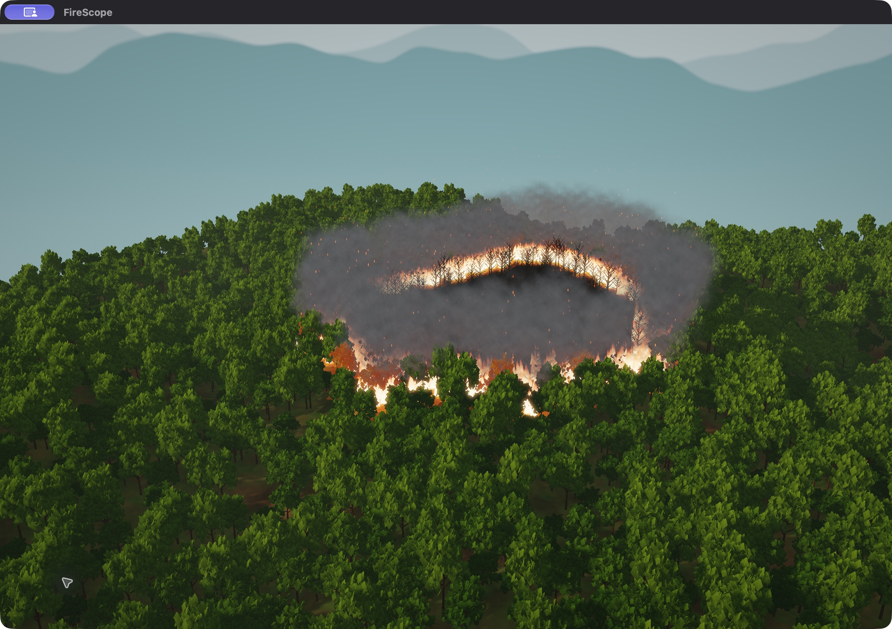

# Cinematic rendering update

Implemented 13 October 2026. The simulation model and compute kernels are unchanged.

## Render pipeline

1. Render terrain and alpha-cut foliage into the existing 2048² directional
   shadow depth map. The sun is lower, producing longer shadows.
2. Render sky, terrain, trees and sorted particles into an RGBA16F scene target
   with its own depth texture. Material colors are converted to linear values;
   emissive fire and embers can exceed one without clipping.
3. Extract light above one and run six separable blur passes through two
   half-resolution RGBA16F targets. The final pass is sampled for bloom.
4. Reconstruct the surface position from scene depth. March twelve bounded
   samples between the camera and surface, with exponentially declining height
   density and shadow-map visibility. This approximates atmospheric scattering
   and sunlight shafts; it does not simulate fluid smoke.
5. Composite bloom and atmosphere, apply a filmic curve, convert to display
   gamma and apply a mild vignette. ImGui renders afterward, so text is unaffected.

Targets are recreated when the viewport changes size. Every framebuffer is
checked for completeness; incomplete targets produce a descriptive error.
Bloom is skipped when disabled or set to zero. Disabling cinematic effects also
skips scattering and the vignette; tone mapping remains necessary for HDR fire.
The interface-free F10 viewport uses the entire client area and disables editing.

## Scene and effects

The backdrop uses four-octave clouds, a warm sun halo and three distant mountain
layers. Mountains are visual silhouettes outside the simulation, with no picking
or fire state. Trees vary in height/width as well as scale, yaw and color. Their
leaf material includes backlit transmission and canopy shading. Neighboring
burning cells illuminate terrain; burning trees receive warm emissive shading.

Each sampled burning cell produces two flame tongues and one ground glow, with
at most 2,048 sampled cells. Smoke remains limited to 4,096 particles and 500
emissions per second. Rising, drifting embers have a separate 1,400-particle cap
and expire after two to five seconds. Transparent particles are sorted by view
depth. Particle animation continues while the cellular model is paused.

These are procedural graphics approximations. Smoke remains billboard particles;
the atmospheric ray march renders ambient haze and shafts. No volumetric smoke,
fluid dynamics, real fire-light transport or spreading firebrands are claimed.

## Presentation controls

- **Cinematic view:** low camera angle with the distant horizon visible.
- **Cinematic lighting:** bloom toggle, exposure, bloom strength and atmosphere.
- **Slow orbit:** gentle camera rotation, stopped by manual rotate/pan.
- **Playback ticks/s:** simulation playback pacing independent of render FPS;
  each tick runs the chosen batch of 1, 2, 4 or 8 updates. Step remains immediate.
- **F10:** hide/show all overlays and controls; camera input stays available.
- **Fire showcase (resets):** rebuild the current seeded scenario, run 55 updates
  and frame the fire. Environment controls are retained, as with Reset.
- **`--showcase`:** the same prepared scene at startup, paused for inspection.

The 128² seed-42 Metal showcase has 641 burning cells, 1,392 burned cells and
14,351 unburned cells at update 55, matching the previously verified scene.
Use 512² for the specification's live Mac demo; use 128² for the close screenshot
scene and its stated counts. The two grid sizes are different workloads.

## Verification

The Release build compiles the embedded shaders at runtime under OpenGL 4.1.
The 512² Metal showcase smoke test passes five render/update frames with no
OpenGL errors. It also resizes the window, switches the atmospheric/bloom path off
and back on, and enters/leaves the full viewport photo mode. The complete nine-test
Mac CPU/Metal correctness suite passes with actual GPU access.

The close camera, full viewport mode, forest shading, fire, smoke and embers were
inspected in the actual native app. This is not a new formal renderer benchmark;
the headless benchmark CSV remains applicable to its stated compute workload.
NVIDIA/Windows graphics and CUDA validation remain pending.
